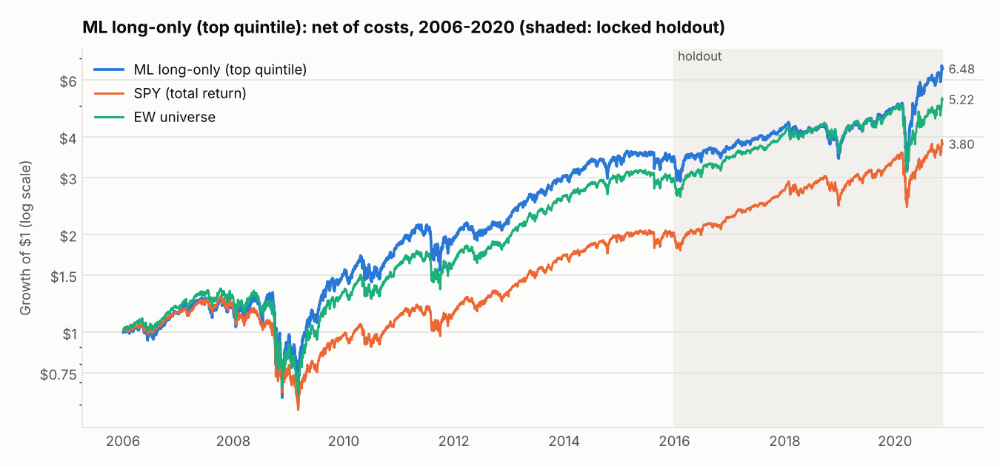
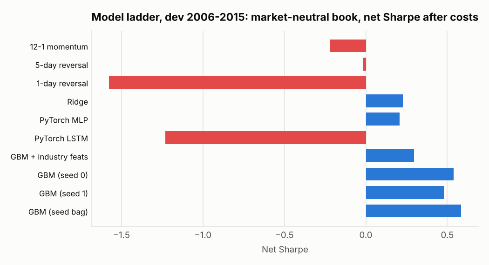
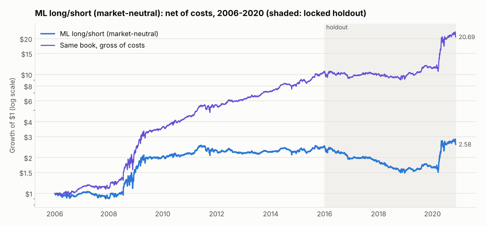
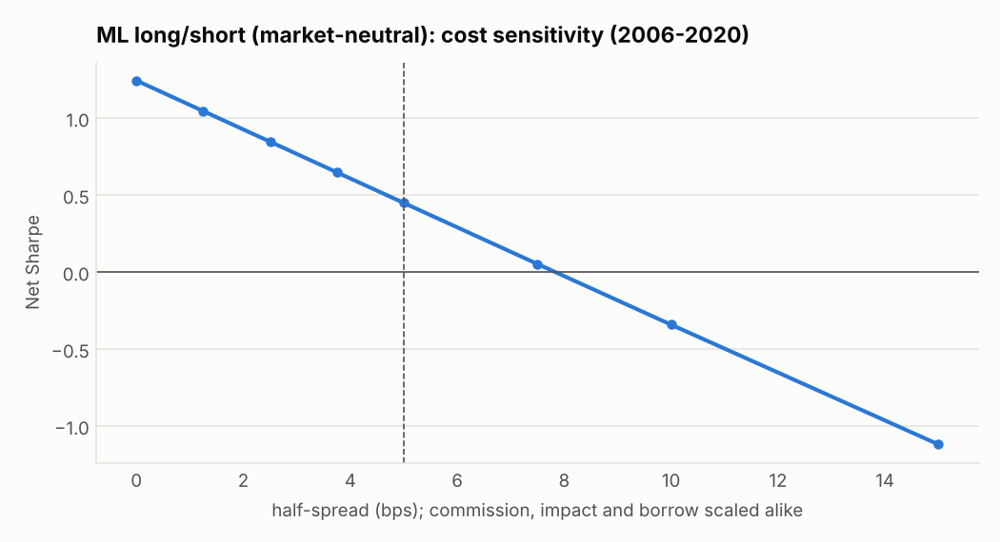
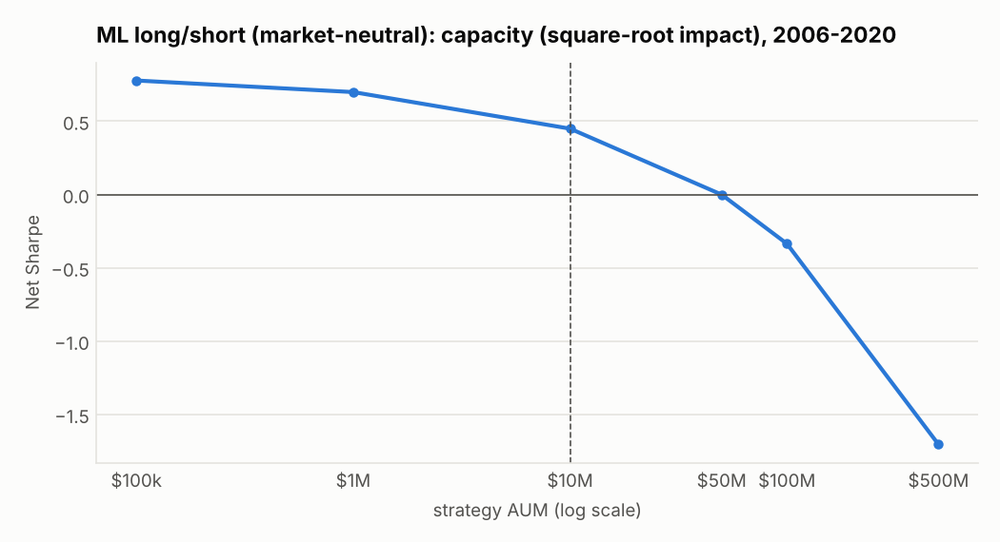
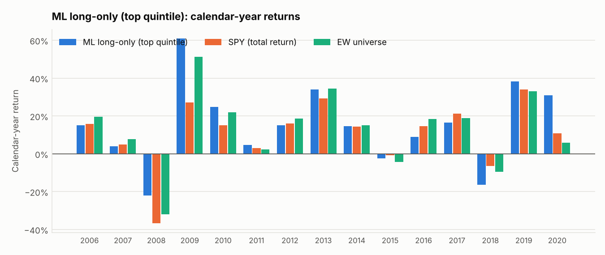
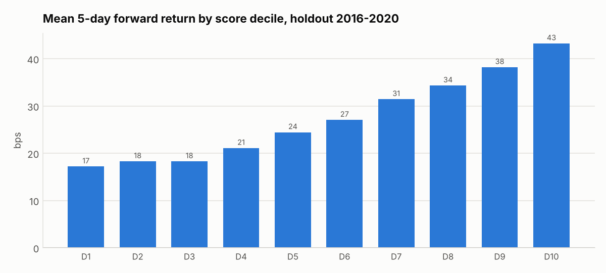
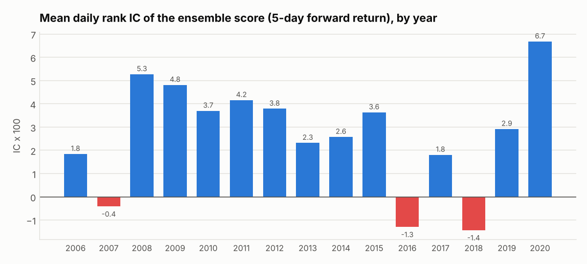
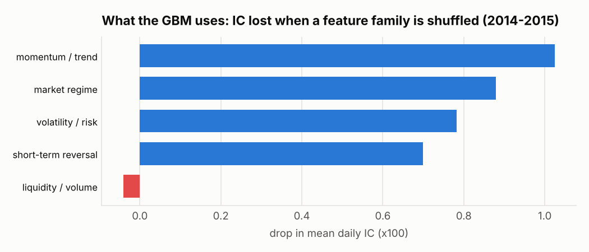

# VELA — Results

All numbers are out-of-sample walk-forward results, **net of costs** unless marked gross.
Sharpe ratios are annualised with a zero risk-free rate. Model selection used only the development
period **2006–2015**. The configuration was frozen and committed (`results/frozen_config.json`,
commit "Freeze strategy configuration before holdout evaluation") before the **holdout 2016-01 → 2020-11**
was run, once, by `scripts/final_evaluation.py`.

## Headline

| Book (net of costs, $10M AUM base case) | Dev 2006–2015 | **Holdout 2016–2020** | Full 2006–2020 |
|---|---|---|---|
| **ML long-only** (top quintile, 2-day hysteresis): net Sharpe | 0.59 | **0.75** | 0.63 |
| …CAGR | 13.0% | **14.3%** | 13.4% |
| …vs SPY (total return): CAGR / Sharpe | 7.0% / 0.44 | 14.5% / 0.87 | 9.4% / 0.56 |
| …vs EW universe: CAGR / information ratio | 11.3% / +0.37 | 12.8% / **+0.27** | 11.8% / +0.34 |
| **ML long/short** (dollar-neutral): net Sharpe (gross) | 0.61 (1.44) | **0.13 (0.86)** | 0.45 (1.25) |
| Signal: mean daily rank IC, 5-day (t-stat) | 0.032 (4.2) | **0.016 (1.3)** | 0.027 (4.2) |

**Verdict.** The machine-learned ranking signal is real: positive out-of-sample IC in 12 of 15 years,
near-monotonic decile returns in both periods, IC t-stat 4.2 over 2006–2020. It is also 1.8x as strong as the best single-factor
baseline over the same period (5-day reversal: IC 0.015, t = 2.4). In the locked holdout it was half as strong as in development.

- The **long-only book** turned $1 into $6.48 over 2006–2020, against $3.80 for SPY and $5.22 for the
  equal-weighted universe. In the holdout it beat the EW benchmark but not SPY's mega-cap-led rally.
  A $100k paper-trading replay of the holdout through the trade ledger returned **+108% vs SPY +93%**.
- The **dollar-neutral long/short book** has a gross Sharpe of 1.25 over 15 years, but most of that goes to trading
  costs at institutional size. Its profits are concentrated in high-volatility regimes (2008–09, 2020),
  and it lost money in 2016–2018, a mostly low-volatility stretch (§8).
- **Multiple testing:** after deflating for the 136 development trials, the development Sharpe is not
  statistically significant on its own (DSR 0.23). The holdout, run once, is the more reliable evidence.




---

## 1. Data and setup

| Item | Value |
|---|---|
| Source | Microsoft Qlib US daily dataset (Yahoo Finance), 2000-01-03 → 2020-11-10 (5,250 trading days) |
| Universe | Point-in-time S&P 500 members with valid prices, 21-day median dollar volume ≥ $5M, ≥ 126 days of history |
| Universe size | ~290 names (2000) → ~440 (2015) → ~500 (2020) |
| Cleaning | 8 tickers with ≥ 2 impossible (×3 or ÷3) moves inside their membership window dropped; 756 OHLC bars repaired; real crashes kept (D3) |
| Features | 53 causal price/volume features, cross-sectionally ranked daily (`vela/features.py`) |
| Target | Rank of the 5-day open-to-open return starting at the next open (the actual execution price) |
| Validation | Annual walk-forward, expanding window from 2001, purge = horizon + 2 days, last training year used for early stopping |
| Execution | Signals at close *t*, trades at the open of *t+1* |
| Costs (base case) | 5 bps half-spread + 0.5 bps commission + square-root impact (σ·√(trade/ADV), $10M AUM) + 50 bps/yr borrow |
| Benchmarks | SPY (total return); equal-weighted tradable universe (EW), which carries the same residual survivorship bias as the strategy |

## 2. Model development (dev 2006–2015)

Every model below is evaluated with the *same* frozen portfolio construction and costs
(`results/model_ladder.csv`):

| Model | IC 5d | IC t | Decile spread (bps/5d) | L/S gross Sharpe | L/S net Sharpe | Long-only IR vs SPY | Long-only IR vs EW |
|---|---|---|---|---|---|---|---|
| 12-1 momentum | 0.017 | 1.9 | −7.9 | −0.13 | −0.22 | 0.29 | −0.38 |
| 1-day reversal | 0.012 | 1.8 | 25.1 | 0.94 | −1.58 | −0.64 | −1.54 |
| 5-day reversal | 0.013 | 2.0 | 26.3 | 1.10 | −0.02 | 0.35 | −0.15 |
| Ridge | 0.020 | 3.1 | 30.2 | 1.11 | 0.23 | 0.57 | 0.06 |
| PyTorch MLP | 0.024 | 3.2 | 31.5 | 0.99 | 0.21 | 0.51 | 0.06 |
| PyTorch LSTM (raw sequences) | 0.008 | 1.5 | 16.2 | 0.91 | −1.23 | −0.30 | −1.44 |
| GBM + statistical-industry features | 0.028 | 3.8 | 40.9 | 1.12 | 0.30 | 0.62 | 0.26 |
| **GBM, 53 features (2-seed bag)** | **0.031** | **4.2** | **48.7** | **1.42** | **0.58** | **0.69** | **0.33** |



Main development findings (full story in [DEVLOG.md](DEVLOG.md)):

- **Costs are the binding constraint.** Daily 1-day reversal has a real edge (t = 3.4) but turns over 340% of
  NAV a day; costs turn its gross Sharpe of 0.96 into −6.1.
- **The signal decays in about three days** (IC by holding day: 0.018, 0.016, 0.011, 0.003). Hysteresis bands
  with a 2-day cadence harvest it at about a quarter of the turnover of naive daily rebalancing (51% vs 192% a day).
- **Gradient boosting beats linear and neural models** on these tabular features. The difference comes
  from interactions with the market state (see §6).
- **Negative results kept:** statistical-industry features, a 21-day horizon, a volatility-scaled target, a
  GBM+MLP ensemble and inverse-volatility sizing all made things worse.
- **Seed noise is large.** A different random seed alone moved weekly L/S net Sharpe from 0.27 to 0.04, so the
  final model bags three seeds.

## 3. Dollar-neutral long/short book (pre-registered)

Long the top 10% / short the bottom 10% of scores, each position held until its rank crosses the median,
rebalanced every 2 days, sized ∝ √ADV, 100% long / 100% short. The book is dollar-neutral, not beta-neutral:
its long leg holds somewhat higher-beta names, leaving a residual beta of 0.1–0.3. Beta-neutral scaling
raised gross Sharpe but lowered net Sharpe through extra turnover, so it was rejected (D10). The chart titles
below say "market-neutral"; read that as dollar-neutral.

| | Dev 2006–15 | Holdout 2016–20 | Full |
|---|---|---|---|
| Net Sharpe (gross) | 0.61 (1.44) | 0.13 (0.86) | 0.45 (1.25) |
| Net CAGR / volatility | 9.5% / 17.5% | 0.8% / 18.1% | 6.6% / 17.7% |
| Max drawdown | −26% | −40% | −42% |
| Turnover (one-way, per day) / cost | 51% / 5.8 bps | 51% / 5.2 bps | 51% / 5.6 bps |
| Beta to SPY | 0.33 | 0.13 | 0.28 |
| Bootstrap 95% CI of net Sharpe | [0.11, 1.09] | [−1.01, 1.05] | [−0.04, 0.89] |



**Costs and capacity** (full period). Break-even half-spread is **7.8 bps**, against 5 bps assumed. Because of
square-root impact, net Sharpe falls with size: **0.78 at $100k, 0.70 at $1M, 0.45 at $10M, 0.00 at $50M**.
This is a small-capital strategy.

|  |  |
|---|---|

Robustness (full period): stock returns clipped at ±25% (data-glitch test) give Sharpe 0.41 (vs 0.45).
**Executing at the next close instead of the next open: 0.21.** The signal is fast, so a one-day
execution delay costs about half the edge.

## 4. Long-only book and the paper account (pre-registered)

Buy the top 20% of scores, hold until the rank falls below the 40th percentile, rebalance every 2 days,
equal weight (~150–180 names).

| | Dev 2006–15 | Holdout 2016–20 | Full |
|---|---|---|---|
| Net Sharpe (gross) | 0.59 (0.80) | 0.75 (0.98) | 0.63 (0.85) |
| Net CAGR / max drawdown | 13.0% / −53% | 14.3% / −38% | 13.4% / −53% |
| Alpha vs SPY, annual (Newey-West t) | +4.8% (1.8) | −0.8% (−0.2) | +2.6% (1.2) |
| Beta to SPY | 1.23 | 1.09 | 1.20 |
| Information ratio vs SPY / vs EW | 0.71 / 0.37 | 0.05 / 0.27 | 0.51 / 0.34 |
| Turnover / cost per day | 21% / 2.2 bps | 21% / 1.9 bps | 21% / 2.1 bps |



The long-only book is robust to execution timing (next-close Sharpe 0.58 vs 0.63) and to costs (still
positive at 3× the base case). It still earns Sharpe 0.43 at $100M AUM. Much of its outperformance of
SPY comes from tilting toward the equal-weighted universe, whose 2006–2015 premium over SPY is partly
survivorship bias (§9). The fair measure of skill is the **IR against EW: +0.37 in development, +0.27
in the holdout.**

**Paper-trading replay of the holdout** (`vela/tracker/paper.py`, `scripts/track_portfolio.py --demo`):
a $100,000 account trades the frozen long-only book order by order: fills at the next open ± 5 bps,
0.5 bps commission, fractional shares, 134,103 fills. It ends at **$208,231 (+108.2%) vs SPY +93.4%**:
Sharpe 0.83, max drawdown −38% (March 2020), beta 1.09, IR vs SPY 0.25. The vectorised engine's figure for
the same book at $10M AUM (with market impact) is +91.6%; the gap is the impact a $100k account does not pay.

## 5. Signal quality and statistical significance

| | Dev | Holdout |
|---|---|---|
| Mean daily rank IC, 5-day (t, overlap-adjusted) | 0.032 (4.2) | 0.016 (1.3) |
| Top-minus-bottom decile, 5-day forward return | 49.5 bps | 26.1 bps |




- Deciles stay near-monotonic in the holdout (only D2/D3 tie): the signal still ranks stocks out of sample, just less sharply.
- IC is positive in 12 of 15 years. The negative years are 2007 (−0.004), 2016 (−0.013) and 2018 (−0.014).
  The strongest years are the crises: 2008 (+0.053), 2009 (+0.048) and 2020 (+0.067).
- Signal decay (IC by holding day, full period): 0.019, 0.013, 0.010, 0.004 (day 5), 0.001 (day 10).
- **Probabilistic Sharpe** (P[true Sharpe > 0]): L/S 0.98 (dev), 0.62 (holdout); long-only 0.97 (dev), 0.95 (holdout).
- **Deflated Sharpe Ratio** for the development period with 136 trials: 0.23 (L/S) and 0.22 (long-only)
  using the textbook null variance. The hurdle is an annualised Sharpe of 0.83, which a dev Sharpe of
  ~0.6 does not clear. Using the empirical cross-trial variance (which includes deliberately extreme
  trials) the hurdle is 2.1, and DSR ≈ 0. Read this as: *the development search alone does not prove
  skill*. That is why a locked holdout was kept, and why its weaker numbers are the ones to quote.


## 6. What the model learned

Grouped permutation importance (train 2001–12, validate 2013, measure 2014–15; each feature family shuffled
across stocks within dates, market-level features swapped across dates):



Momentum/trend, market regime, volatility and short-term reversal all matter in similar measure; liquidity
features are unused. The market-regime features are constant across stocks on any given day, so they can
only help through interactions, conditioning stock-level bets on the market state. A linear model cannot
represent that.

## 7. Engine validation

- **Look-ahead canary** (`tests/test_engine.py`): a signal that peeks one bar ahead earns Sharpe > 20 in the
  engine; the same signal lagged correctly earns ≈ 0.
- **Feature causality**: features at date *D* are identical when all data after *D* is deleted.
- **Independent re-implementation**: an event-driven, order-by-order ledger simulation of the long-only book
  (2012–2015, 96,704 fills) matches the vectorised engine's total return to within 0.12 pp
  (91.06% vs 91.18%), with daily-return correlation 0.9995.
- 35 unit tests in total (`pytest`), run in CI on every push.


## 8. Post-holdout diagnosis: why the L/S book struggled in 2016–2019

*This analysis was done after seeing the holdout. It explains the result; it does not change it.*

Daily L/S returns bucketed by the market-volatility regime known at the time (terciles of trailing 21-day
volatility of the EW universe, `results/final/ls_regime_analysis.csv`):

| Regime | Market vol | Gross return/yr | Net return/yr | Gross Sharpe |
|---|---|---|---|---|
| Calm | 8.5% | 9.9% | −1.5% | 1.29 |
| Normal | 14.0% | 15.2% | +2.4% | 1.47 |
| Stressed | 31.7% | 40.8% | +22.9% | 1.47 |

The *gross* edge scales with volatility, with a similar Sharpe in every regime. Trading costs barely do
(11–17%/yr). So the book loses money in calm markets and earns in stressed ones. This matches the
literature's reading of short-term reversal as a return to **liquidity provision**, which is highest when
volatility spikes (Nagel 2012, *Evaporating Liquidity*). The holdout had fewer stressed days than
development (27% vs 36%), and 2016–2017 in particular were unusually calm.

Implied next step, **untested** because it was suggested by the holdout itself: make trading intensity
regime-aware, e.g. widen the hysteresis band or cut gross exposure when trailing volatility is low.
Validating it properly needs data after 2020-11.

## 9. Limitations

- **Data ends 2020-11.** It was the only full-history source reachable from the build environment. The holdout
  covers 2016–2020, including the 2018 Q4 sell-off and the 2020 COVID crash.
- **Residual survivorship bias.** 86 of 755 historical members lack price data, mostly acquired or bankrupt
  firms. This flatters long-only results against SPY. The EW benchmark shares the bias, so IR vs EW is the
  fairer measure of skill.
- **Modelled costs.** No quote data was available to calibrate spreads. The base case is deliberately
  conservative, and cost and capacity curves are reported so the reader can substitute their own assumptions.
- **Shorting frictions** beyond a flat 50 bps/yr borrow (recalls, hard-to-borrow names, short-sale bans in 2008)
  are not modelled.
- **No risk-free rate.** Sharpe ratios use rf = 0.
- **Multiple testing.** About 150 configurations were evaluated on the development period. The Deflated
  Sharpe Ratio (§5) accounts for this, and the holdout was run once.

## 10. Reproducing these numbers

```bash
python scripts/final_scores.py       # frozen models, 2006-2020 walk-forward (~45 min on 4 cores)
python scripts/final_evaluation.py   # all tables and figures above; results/final/summary.json
```
